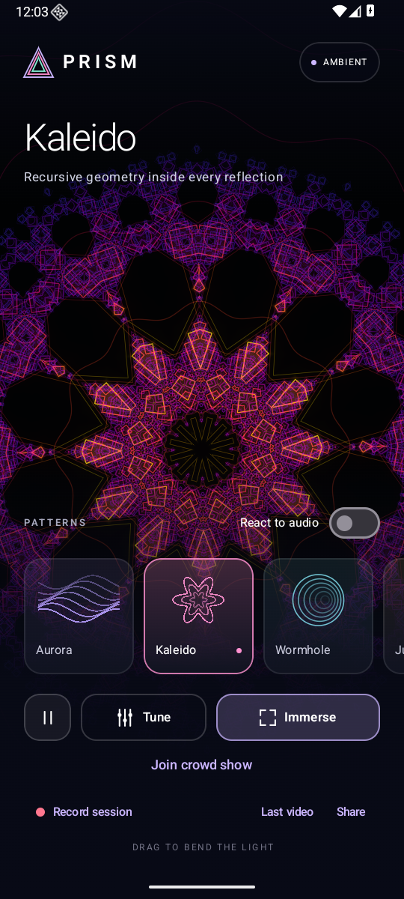
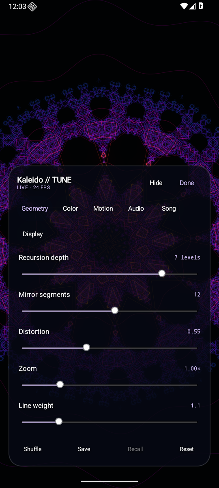
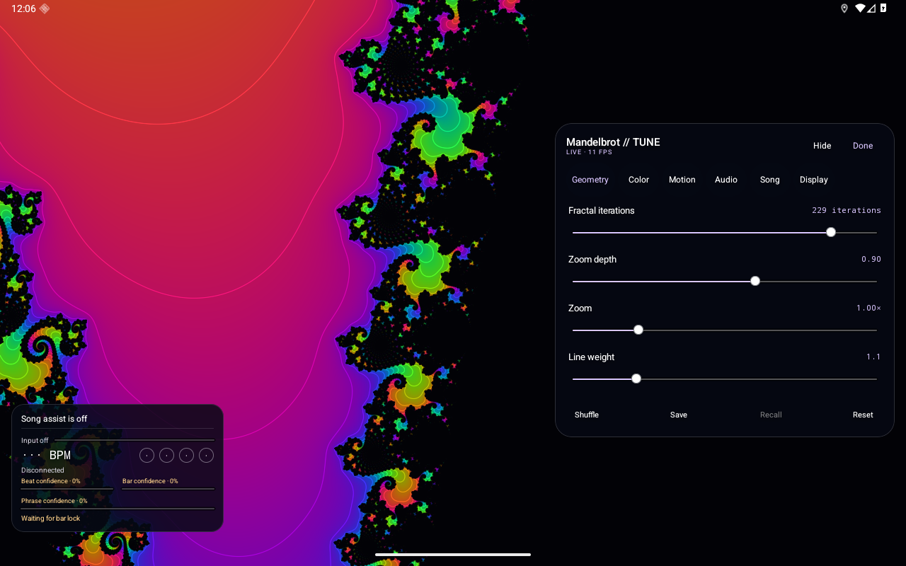
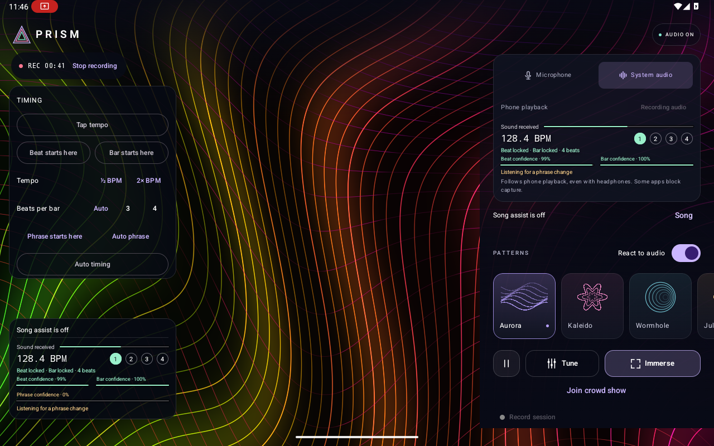

# Prism

A native Android psychedelic visualizer. Kotlin, Jetpack Compose, and six original OpenGL ES 3 patterns. Android 10 or newer.

[Download Prism 1.9.0](https://github.com/xklob/prism/releases/tag/v1.9.0) for tablet settings and monitoring, improved rhythm continuity, Mandelbrot zoom, and Equalizer.

## Screenshots

Phone portrait: pattern selection and the compact settings panel.

<p>
  
  
</p>

Tablet landscape: Mandelbrot settings alongside the persistent monitor.



Manual timing controls and the beat/bar/phrase monitor remain separate from recording and scene controls.



These are unedited Android 16 emulator captures of the 1.9 UI, at phone and tablet window sizes. The live timing view uses an original synthetic music fixture. On-screen FPS reflects the emulator, not physical-device performance.

## Crowd mode

Prism includes a Windows controller that uses the computer's own Wi-Fi card through Mobile Hotspot. Install the APK on the phones, extract the Windows controller ZIP from the [release](https://github.com/xklob/prism/releases/tag/v1.9.0), and double-click **Start-Prism.cmd**. The local dashboard provides audience invitations, a shared tempo and bar clock, five geometric patterns, scheduled flashes and color inversion, and per-phone timing diagnostics.

See [the controller guide](controller/README.md) for setup, audio input, timing limits, and testing. Physical multi-phone timing and the laptop's adapter and firewall setup still need field testing. Software clock estimates do not establish physical synchronization between different phone screens.

## Scenes

| Pattern | Optional audio response |
| --- | --- |
| Aurora: interwoven contour fields | Expanding currents, bending contours, shifting detail |
| Kaleido: recursive mirrored geometry | Pulsing scale, changing folds and nested geometry |
| Wormhole: an engraved geometric tunnel | Beat-driven depth, bar accents, rhythmic twist |
| Julia: an evolving Julia fractal | Fractal deformation, breathing scale, shifting contours |
| Mandelbrot: a smooth logarithmic zoom into the set | Beat-driven scale, bar accents, palette motion |
| Equalizer: live frequency bars | 8–64 bands, peak hold, mirrored or radial layouts, LED segments |

The five geometric patterns work independently of audio. Equalizer displays the captured frequency spectrum and waits for audio instead of inventing movement. Its audio toggle starts enabled, but capture still requires **Connect audio**. **React to audio** is remembered separately for each pattern. The old Pulse, Strings, and Nova scenes have been removed. No simulated audio signal is used.

## Use

1. [Download the APK from GitHub Releases](https://github.com/xklob/prism/releases/latest) and install it on an Android device.
2. Select a pattern.
3. To follow music, enable **React to audio**, choose **Microphone** or **System audio**, then **Connect audio**. Leave the switch off for ambient animation.
4. Open **Tune** for controls in a semi-transparent panel over the full-size visual. Landscape and tablet windows use a wider right-side panel; smaller windows use a bottom panel. The heading, tabs, and actions stay together while the settings scroll. The uncovered visual stays unchanged. While dragging a slider, other controls fade away. **Hide** removes the controls until **Show controls** is tapped; **Done** returns to the scene browser.
5. Tap **Immerse** for fullscreen. Tap the visual or use Back to restore the controls. Drag the visual to shift its center.
6. Tap **Record session**, choose **Microphone** or **System audio**, then **Start recording**. Stop with the recording badge, which stays visible in fullscreen and while tuning.

System audio follows media/game playback from compatible apps, including playback through headphones. Grant Android's audio permission and device capture consent, then play music. The projection permission captures audio; Prism renders its own video frames directly and never records other apps' screens. Some apps prohibit playback capture. Switch to the microphone if their audio remains silent. Phone calls are not captured. Android documents these limitations at <https://developer.android.com/media/platform/av-capture>.

System capture continues when you switch to your music app. Allow notifications for an ongoing notification with a Stop button. Disconnect with **Stop**, the notification's **Stop**, Android's capture control, or by turning off **React to audio**. Switching to a pattern whose audio toggle is off also stops capture. Switching between enabled patterns retains the active session. Pausing disconnects audio; reconnect to resume audio response. Removing Prism from recents ends system capture. Microphone capture stops whenever Prism leaves the foreground and resumes the already-authorized session when you return.

Microphone capture prefers Android's unprocessed input when the device supports it, with voice-recognition input as a fallback. This preserves musical transients without enabling speech-oriented gain control or noise suppression. See [Android's recording guidance](https://developer.android.com/media/platform/mediarecorder).

## Session recording

Recordings save the full visualizer image with the selected audio to **Movies/Prism** as H.264/AAC MP4 files. Controls, notifications, and tuning overlays stay out of the video. **Last video** opens the latest recording; **Share** opens Android's share sheet. Videos also appear in Photos or Files. No storage permission is needed on supported Android versions.

Recording works with ambient or audio-reactive patterns. Change patterns, drag the image, adjust tuning, or pause the animation while recording. The selected audio source stays connected until recording stops, even when **React to audio** is off. Source switching is disabled during recording. Leaving Prism, locking the phone, or losing audio capture finishes the current recording. Start a new recording when you return. Normal audio-reactivity capture behavior resumes afterward.

Video targets 30 fps, preserves the screen's aspect ratio, and uses the largest supported encoder size up to a 1,920-pixel longest edge. Orientation locks for the recording. Actual frame rate depends on rendering and encoding capacity. Microphone audio is mono; system audio is stereo where supported. The recorder receives the original 48 kHz PCM before analysis gain, using the same capture clock as the visuals. A common timeline preserves initial silence and capture gaps rather than shifting audio against the video. Pending files are made visible only after both tracks finish successfully; failed exports are removed.

## Tablet display and new patterns

Tablet windows show the current song, input level, BPM, beat/bar confidence, and phrase confidence in a semi-transparent bottom-left monitor. It remains visible while tuning, hiding controls, and in fullscreen. Toggle it with **Tune → Display → Tablet monitor**. This global preference survives scene changes and app restarts. The monitor is excluded from session recordings. Manual tempo, beat/bar alignment, phrase alignment, and Auto controls live in a separate left-side timing box above the monitor while controls are shown. Fullscreen hides the timing controls but keeps the monitor. Narrow split-screen windows use the compact layout.

**Mandelbrot** follows a smooth out-and-back zoom into a fixed boundary location. **Zoom speed** controls travel and **Zoom depth** controls its range. Iterations, magnification, rotation, line weight, and palettes remain adjustable. Zoom is bounded to preserve mobile floating-point detail; this is not an unlimited deep-zoom explorer.

**Equalizer** uses the live FFT spectrum. **Geometry** provides 8–64 frequency buckets, bar height, spacing, falloff, peak hold (including Off), mirrored bars, a radial layout, and LED segments. **Color** controls the palette, cycling, hue, saturation, brightness, and contrast. The display uses logarithmic frequency spacing from 35 Hz to 16 kHz; fractional FFT-bin overlap avoids empty narrow bass buckets, but does not add frequency resolution beyond the 2,048-sample analysis window. Source, input gain, and optional downbeat effects are in **Audio**. Saved looks preserve the equalizer settings.

Aurora now separates broad folds from fine woven contours. Kaleido uses shaded facets and a clearer hierarchy of recursive lines. Wormhole closes its angular color seam and fades undersampled detail near the center to reduce flicker.

## Tuning

| Tab | Controls |
| --- | --- |
| Geometry | Scene-specific detail/recursion/iteration count, symmetry, distortion, zoom, line weight |
| Color | Four palettes, hue shift, saturation, brightness, contrast |
| Motion | Travel speed, signed rotation speed, shape evolution, color cycling, battery saver |
| Audio (all patterns) | Per-pattern enable, input source, Input meter, BPM and beat indicators, separate beat/bar confidence, timing corrections, reaction strength, beat pulse, bar accent, downbeat flash, color inversion, invert fade, musical motion, pulse length, sync offset, input gain, optional audio texture |
| Song | Optional playback metadata and BPM lookup, AudD audio identification, encrypted API-key entry, song progress, 8/16/32-bar phrase estimates, manual phrase alignment |
| Display | Persistent tablet song/timing monitor |

Audio response follows musical timing. Each predicted beat uses a short eased rise that peaks on the beat, followed by a smooth return, avoiding an abrupt scale reset; the first beat of a detected bar adds a separate accent; **Musical motion** moves the geometry smoothly across the beat or bar. The detector uses two complementary local beat/downbeat models, then tracks tempo, phase, and competing 3-beat and 4-beat bar hypotheses. Each model has its own tracker; switching requires sustained stronger evidence, and manual alignment stays in control. Confidence includes how well recent detected beats line up with the actual visual clock. Weak offbeat predictions cannot displace an established grid. When recent beats stop matching, the tracker can discard stale evidence and reacquire a quieter rhythm, including phase changes at the same BPM. Sustained disagreement between equally strong models is reported as uncertain instead of silently treating one as reliable. Beat and bar lock are separate: repeated beats alone do not establish a measure boundary. Allow a few seconds for beat lock and several measures for bar evidence. Silence stops modulation.

Room recordings can spread one beat into several prediction peaks. When isolated onsets fail, a second tracking strategy compares complete activation envelopes across several beat periods in a rolling eight-second window. It acquires tempo and phase from repetition, still requires fresh matching beats, and collects bar evidence over each beat's window. It uses the same two neural predictions without extra model inference. Sustained evidence is required to change strategies, and manual tempo or bar alignment remains in control. The audio resampler preserves the model's complete trained frequency range, including treble transients.

The main audio controls and Audio panel show **Sound received** with a live input meter, separate **Beat confidence** and **Bar confidence** bars, and a numbered beat indicator. Green means timing is established; amber means it is still uncertain. **Holding tempo** means the established grid is being predicted through an audible section without clear percussion; retained bars are labeled **predicted**. **Coasting** means the hold has expired or the recent evidence no longer supports it. **Input stalled** means analysis has stopped updating. The display suggests tap tempo or bar alignment when useful. Confidence percentages describe evidence strength, not a calibrated probability of correctness; manual overrides are labeled **manual**.

On beat 1 of an established bar, **Downbeat flash** adds a 35 ms white strobe and **Color inversion** inverts every RGB channel, then fades back over **180 ms** by default. Adjust either strength independently, or set it to zero; **Invert fade** ranges from 60 to 400 ms. These controls are remembered per pattern and in saved looks. Acquiring a bar lock halfway through a measure, correcting its origin, returning from pause, or losing confidence does not cause a stray flash. Downbeat effects wait for the next continuous bar boundary and stop when timing is uncertain.

Automatic tracking requires spectral changes in the input. A steady tone does not become a repeating visual beat; an already-established clock can continue across a drumless section.

**Reaction strength** scales all modulation, including values above 100%. Set it to zero for the original ambient image, or disable **React to audio** to also stop capture. **Beat pulse**, **Bar accent**, and **Musical motion** are independent; **Pulse length** is measured in beats so it follows tempo. The optional **Extra audio texture** adds a little treble-dependent detail and defaults to zero. Raw volume does not drive the geometric patterns' default movement; Equalizer intentionally follows the live spectrum.

Automatic tempo estimates use a rolling 12-second history weighted by recency and evidence strength. Missing beats do not contribute zero-tempo votes. Once the rate is stable, an audible drumless bridge retains beat and established bar confidence for up to eight bars, extended to 32 bars when the current song lookup agrees. Weak isolated notes do not erase that history. Strong contradictory onsets still trigger recovery, and genuine silence, track changes, seeks, source changes, or stopped capture invalidate stale timing. Confidence decays after the bounded hold expires. Song BPM does not manufacture a bar or phrase origin.

Automatic timing can be ambiguous, especially with syncopation, sparse drums, tempo changes, or unusual meters. The automatic tempo search covers 60–200 BPM and 3/4 or 4/4 meter. Tap **Tap tempo** at least three times to set tempo manually, select **3** or **4** if needed, and tap **Bar starts here** on the first beat. **½ BPM** and **2× BPM** correct half/double-time interpretations. **Beat starts here** corrects beat phase without relabeling the bar. **Auto timing** hands the current manual tempo, beat phase, and bar alignment to all automatic estimators with high initial confidence; it no longer discards that work. A bounded tempo and bar prior favors the manual grid initially, then fades over eight bars while live evidence refines it. The selected meter remains in effect. Manual timing applies only to the active capture session. **Sync offset** advances the visual for positive values and delays it for negative values, up to 250 ms, to compensate for playback routing such as Bluetooth. Input gain boosts quiet recordings automatically and can be adjusted further.

Each scene remembers its own settings. **Shuffle** makes a new visual variation without changing capture or playback state. **Save** stores one favorite look per scene, including its reaction settings; **Recall** restores it; **Reset** returns that scene to its defaults. None of these actions changes the audio enable switch or starts capture. Existing visual preferences migrate automatically. Julia retains its original stable ID; an installation last using a removed scene starts on Aurora with audio disabled. Saved looks do not contain capture permission tokens.

Contours use pixel-width antialiasing without glow or blur. Normal rendering uses the screen's native resolution. AudioLabs (<https://audiolabs.dev>) was inspected as a reference for visual density and detailed controls; Prism's shaders and Android UI are original implementations.

The visualizer and live beat/bar/phrase analysis work offline without an account, analytics, or ads. Optional song assistance uses the network as described below. Audio stays in memory unless you explicitly start recording or enable AudD identification. Recordings stay on the device until you choose to share them. Analysis runs every 20 ms on the capture worker; rendering predicts beat phase at display refresh rate. Android capture timestamps and frontend-delay compensation keep analysis on the same clock as the visuals. Scene and tuning preferences are saved locally. Capture consent is never saved or reused across sessions.

## Song assistance and phrases

Open **Tune → Song**, or the **Song** button under the audio monitor. Song assistance and audio identification both default to off. They are global preferences rather than part of a saved visual look.

Enable **Song assist** to look up song length and BPM using [ReccoBeats](https://reccobeats.com/docs/documentation/introduction). It needs no API key. Only the track ID or title is sent to ReccoBeats, never audio. A bounded in-memory cache avoids repeating successful lookups for a day and missing matches for five minutes, for the lifetime of the activity. Errors and rate limits back off while the local detector keeps running.

For **system audio**, tap **Allow playback info access** and enable **Prism song information** in Android's Notification access settings. This is separate from microphone permission, normal notification permission, and playback-capture consent. Prism reads active media-session metadata and playback state; it does not read notification messages. Spotify track URIs are used when available. Other tracks require a conservative artist/title and duration match; ambiguous edits and remixes are not silently treated as the original. Actual fields depend on the player. YouTube may expose a video title or channel instead of a recording identity, so optional audio identification can help. Metadata access does not bypass an app's playback-capture restrictions.

For **microphone audio**, or system playback without a usable recording identity, add your own [AudD API key](https://dashboard.audd.io/) and enable **Identify audio with AudD**. This explicitly allows sending an 8–10 second audio clip to AudD. The key is encrypted with Android Keystore, excluded from backup, never logged, and never included in the public APK. Clips are held in a short memory buffer, not written to files. Recognition receives the same captured audio as session recording, so both features work together. Removing the key disables recognition.

Automatic recognition normally checks every 90 seconds when needed, with earlier checks on a track/source change or the recognized recording's end. All attempts, including manual retries and errors, share a 30-second minimum interval and a limit of 40 requests per rolling hour, persisted across app restarts. This device limit is not an account-wide spending cap. AudD advertises a 300-request trial followed by $5 per 1,000 requests as of October 2026. At that price, the local limit allows approximately $0.20/hour. Check the provider's current pricing and account controls. ReccoBeats also has service-side limits. No paid account is bundled or required for direct playback metadata, free BPM lookup, or local timing.

**Identify now** requests a fresh match when enough recent, audible input is available and the request limit allows it. The monitor distinguishes player metadata from an AudD identification. AudD's song position is approximate and is marked **≈**. Spotify/other player positions follow their reported playback speed. A seek, pause, source change, revoked metadata access, or changed recording invalidates stale assistance and phrase alignment. Late network responses cannot restore a previous track. Failed recognition eventually discards an old match, and the original catalog BPM supports a matching live tempo while allowing a different live tempo to take over. Manual tap tempo remains in control.

Catalog BPM helps resolve competing tempo candidates and increases beat confidence modestly when sufficiently strong live observations already agree in tempo and phase. It cannot establish a beat phase or bar boundary by itself. Live audio still establishes the beat phase and first downbeat. Song duration validates recording matches, displays progress, and helps detect a recording ending; it is not a phrase boundary. The monitor labels **Tempo assisted by song lookup** only when automatic timing agrees with the current prior, and reports disagreement when the local detector follows a different tempo.

Phrase tracking is local and works without song assistance. Choose an **8**, **16**, or **32 bar** hypothesis. Sustained changes in whole-bar energy and bass/mid/treble balance suggest an origin; repeated changes at the selected interval increase evidence. Until a change is observed, Prism says it is listening for a phrase change. These are explicitly labeled **estimated**, not known song structure. Because a whole bar must be observed, automatic alignment can arrive one bar late. A section is not necessarily one phrase, and unusual arrangements can defeat this heuristic.

Tap **Phrase starts here** on a known boundary to align both the first downbeat and the phrase counter manually. **Auto phrase** retains the manually aligned phrase origin with high initial confidence and resumes structural inference from it. **Auto timing** also preserves a manual phrase anchor during the handoff. The display labels this initial guidance explicitly; later audio changes may refine it. Phrase length changes, unstable timing, and discontinuities clear the old origin. The numbered counter and confidence are visible in the audio monitor and Song panel. Phrase estimates do not trigger extra strobes or override existing beat/bar effects. Precomputed full-song structure analysis is not included.

Beat/downbeat inference uses [BeatNet](https://github.com/mjhydri/BeatNet) models 1 and 3 by Mojtaba Heydari and contributors, licensed under [CC BY 4.0](https://creativecommons.org/licenses/by/4.0/), converted to ONNX with explicit recurrent state. Prism supplies its own Kotlin frontend and musical tracker. [ONNX Runtime](https://github.com/microsoft/onnxruntime) is MIT-licensed. Attribution, licenses, and model provenance ship in `app/src/main/assets/rhythm/`; reproducible conversion instructions are in [tools/beatnet](tools/beatnet/README.md).

## Build

Requires JDK 17 and Android SDK platform/build tools 36. Set `sdk.dir` in `local.properties`, or set `ANDROID_HOME`.

```sh
./gradlew :app:assembleDebug :app:testDebugUnitTest :app:lintDebug
```

The debug APK is in `app/build/outputs/apk/debug/` and uses package `com.caleb.prism.debug`, so it can coexist with the release. For a release, configure the ignored `signing.properties` file with `storeFile`, `storePassword`, `keyAlias`, and `keyPassword`, then:

```sh
./gradlew :app:assembleRelease :app:lintRelease
```

## Verification

The 1.9 preview passed 80 Android unit tests, nine controller tests, seven native Windows package tests, release build/lint, and focused Android 16 emulator checks at tablet and phone window sizes. The signed release was exercised through captured music, beat/bar lock, manual corrections, automatic handoff, video recording/opening, silence, capture stop, and cold restart. Tablet layout and persistence, shader output, drumless bridges, and playback-metadata lookup were also checked. Physical Pixel Tablet frame rate, thermals, room acoustics, and crowd synchronization still need field testing. This is a focused validation run, not a claim that the complete device-test suite passed.

Stable 1.9.0 keeps that implementation and adds release metadata and the README gallery. Its rebuilt APK passed release lint and signature verification, and was installed over the preview with existing preferences intact. Phone portrait and tablet landscape captures above were inspected in the running app; the live timing capture comes from the preview's signed-release recording check.

Unit tests check the exact audio frontend, resampling, tempo/phase/meter tracking, missing beats, weak offbeat hits, detector conflicts, ambiguous bar evidence, tempo and phase changes, quieter sections, confidence decay, silence, manual corrections, monitor states, and beat/bar envelopes. Downbeat tests cover 3- and 4-beat bars at 30/60/120 fps, flash and fade duration, phase jumps, duplicate crossings, pause, and independent effect controls. Learned activations from original musical fixtures cover 96, 128, and 174 BPM. One syncopated 3/4 fixture intentionally checks manual correction of an ambiguous first beat; automatic bar alignment is not assumed to be infallible.

Additional regression cases cover weighted tempo history, drumless bridges with and without catalog assistance, weak irregular notes, clock expiry, manual-to-auto tempo/phase/bar/phrase guidance, resumed phase and tempo changes, live-spectrum bucket mapping and display-rate smoothing, and broad, echoing beat predictions at 80, 96, 125, and 174 BPM; absolute capture-clock offsets; recovery hysteresis; stale repetition; unstructured activations; and the resampler's full passband against independent reference samples. Synthetic fixtures are original. Private recordings and their traces are excluded from source control and both APKs.

Song-assistance tests cover playback clocks, seeking and speed changes, exact-recording matching, ambiguous/remix rejection, request budgets, mono/stereo recognition buffers and WAV timestamps, stale/silent input, incorrect tempo priors, manual precedence, phrase uncertainty, repeated structural changes, and loss of bar alignment. `SongDeviceTest` exercises a separate test-app media session through Android's actual notification listener, a live ReccoBeats lookup, seek/pause/speed changes, access revocation, encrypted key storage, and overlay preferences. Its fixture service exists only in the test APK. An opt-in `songNetwork=true` check sends only a synthetic tone and deliberately invalid key to AudD to verify transport and authentication failure handling. It does not establish Spotify/YouTube-specific compatibility or AudD recognition accuracy on real room recordings.

`TabletDeviceTest` checks panel reachability, landscape/portrait separation, fullscreen monitor visibility, the persistent toggle, and saved equalizer settings at Pixel Tablet window dimensions. `PrismDeviceTest` checks Android ONNX against reference predictions, processes a full musical PCM fixture, measures analysis speed and phase error, and exercises actual Android system capture. It also checks capture lifecycle, per-pattern toggles, migration, saved looks, immersive controls, and landscape layout. The shipped shader is rendered at fixed phases to verify distinct beat, bar, and musical-motion effects in all geometric patterns, exact RGB inversion, full-frame white flash, and fade interpolation; audio off must produce exactly the original ambient image. Captured music must produce one flash per 4-beat bar. Pixel comparisons verify that the settings panel preserves the uncovered preview and live adjustments. Evidence is written to the app's external `files/review` directory.

The Android pipeline also checks a musical fixture followed by a drumless two-tone bridge and resumed music, and processes a quiet synthetic room recording with delayed reflections and a volume drop. Tempo and phase are checked against the original beat grid. Separate tests reject a steady tone, silence, and unstructured noise.

Recording tests verify timeline alignment, capture gaps, pre-roll, stereo channel order, and clock rounding. `RecordingDeviceTest` exports actual MediaCodec/MediaMuxer videos from system and microphone capture, checks both encoded tracks and increasing timestamps, decodes animated frames, and exercises ambient recording, live pattern/tuning changes, pause, reactivity changes, immersive stop, background saving, repeat recording, permission cancellation, capture interruption, and sharing. Its system-audio fixture plays distinct left/right tones, then decodes the exported AAC to check sound levels and channel separation. Test recordings use synthetic audio and are not bundled with the app.

```sh
./gradlew :app:connectedDebugAndroidTest
```

The device tests grant audio access, approve Android's capture dialog, and play an original musical fixture on the test device. Use an emulator or a device prepared for testing.

An optional local-recording probe runs through the same Android preprocessing, neural models, and timing selection. It is skipped by normal test runs. With the debug and test APKs installed:

```sh
mkdir -p review
ffmpeg -i recording.m4a -ac 1 -ar 48000 -f s16le review/input.pcm
adb shell mkdir -p /sdcard/Android/data/com.caleb.prism.debug/files/review
adb push review/input.pcm /sdcard/Android/data/com.caleb.prism.debug/files/review/input.pcm
adb shell am instrument -w -e recordedAudio true \
  -e class com.caleb.prism.RecordedAudioProbe \
  com.caleb.prism.debug.test/androidx.test.runner.AndroidJUnitRunner
adb pull /sdcard/Android/data/com.caleb.prism.debug/files/review/recorded-audio.csv review/
```

Supply at least three seconds of mono 48 kHz signed 16-bit PCM. The probe writes timing, model activations, and analysis costs to the app's external `files/review` directory. These report detector behavior; beat accuracy requires comparison with known or independently annotated timing. Keep personal audio and derived traces in ignored local folders.

After installing the signed release alongside the debug and test APKs, the optional release smoke test verifies actual inference after R8 shrinking, system capture, tempo corrections, manual bar alignment, automatic recovery, session recording, opening the saved video, and restart behavior:

```sh
adb shell am instrument -w -e releaseSmoke true \
  -e class com.caleb.prism.ReleaseRhythmSmokeTest \
  com.caleb.prism.debug.test/androidx.test.runner.AndroidJUnitRunner
```

Normal rendering uses native resolution at approximately 60 fps. Battery saver lowers this to a 1,080-pixel longest edge and approximately 30 fps. The tuning overlay shows measured frame rate. Background rendering stops with the activity lifecycle. Paused rendering uses a low refresh rate while still accepting visual adjustments. Actual frame rate depends on the device and scene complexity.
