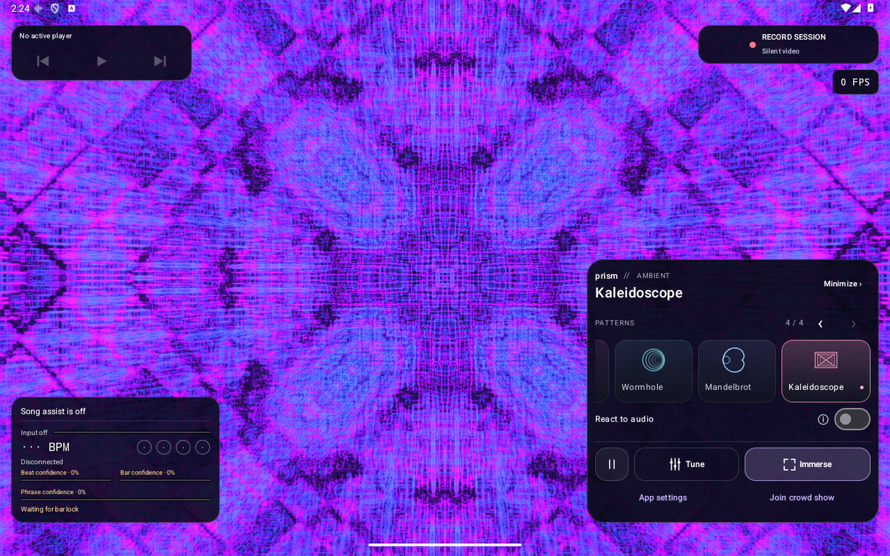
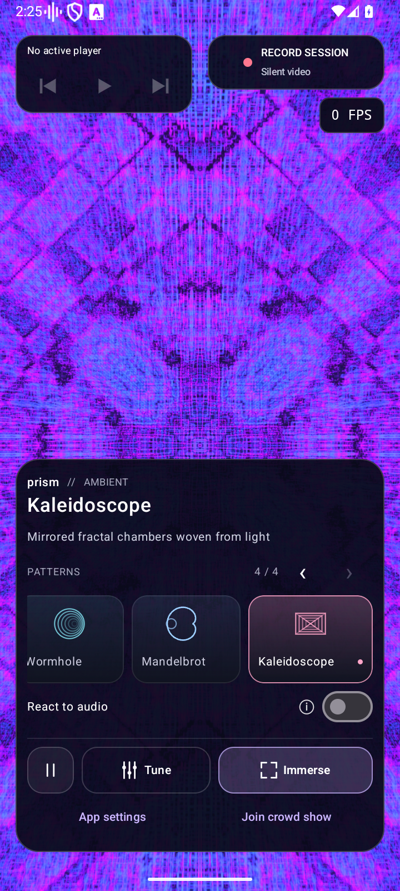
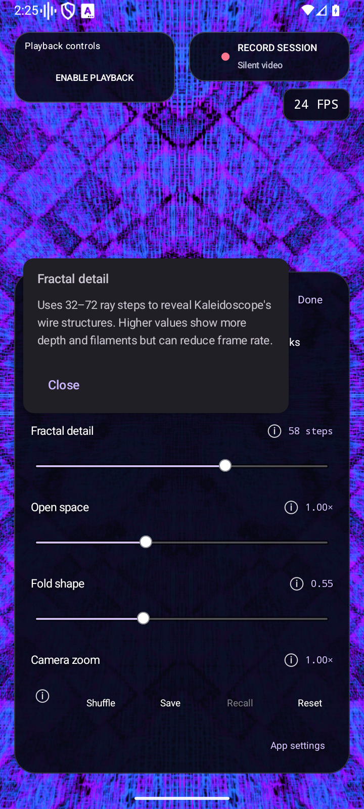
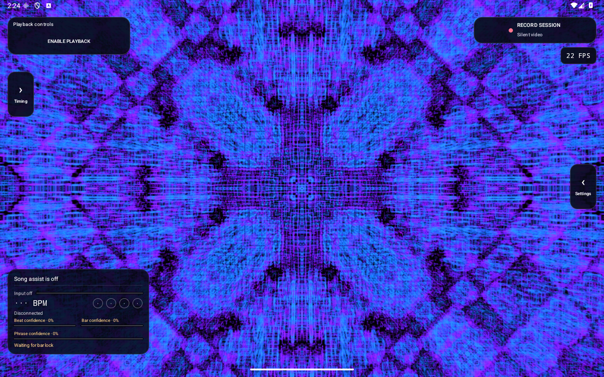
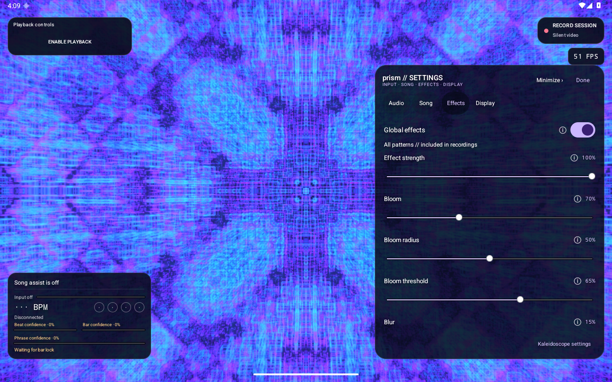
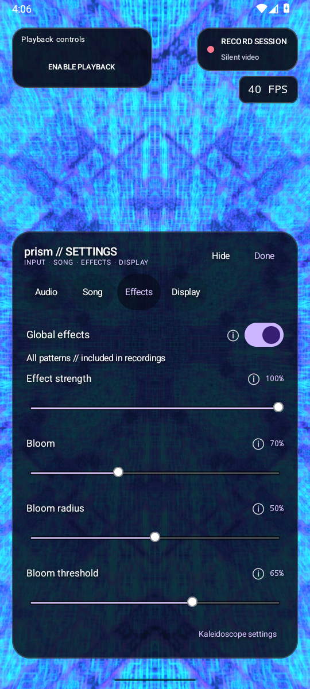
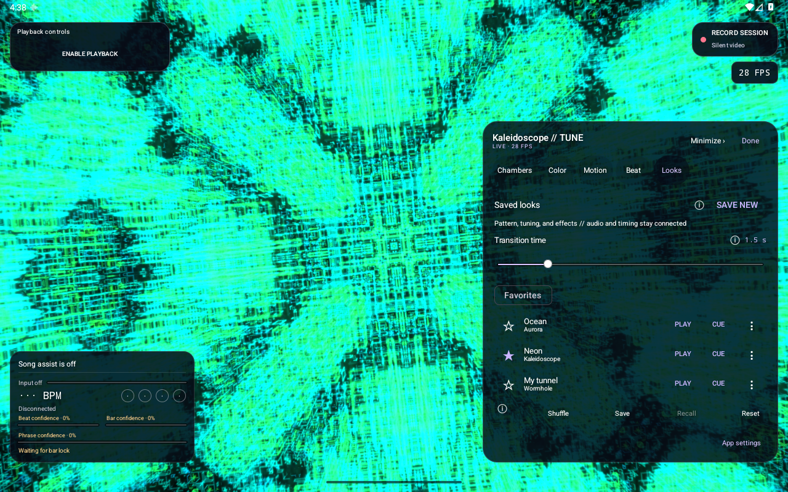
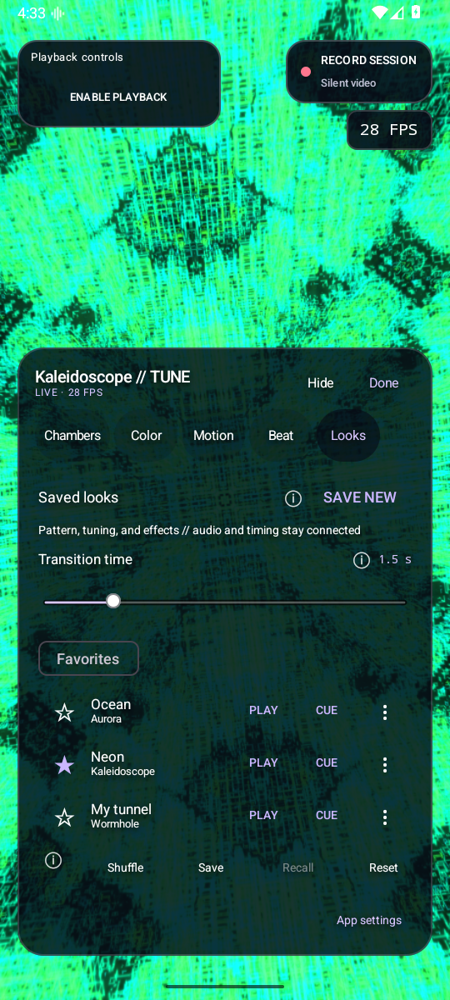
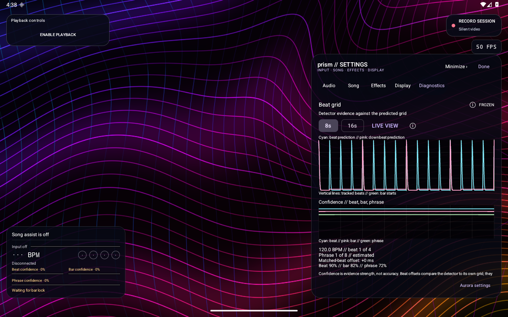

# prism


A native Android psychedelic visualizer. Kotlin, Jetpack Compose, and four OpenGL ES 3 patterns. Android 10 or newer.

[Download prism 1.14.0](https://github.com/xklob/prism/releases/tag/v1.14.0) for optional Spotify compatibility through Shizuku, recording at the live visualizer size and frame cadence where supported, and four visual patterns.

## Screenshots

Landscape tablet: the selected pattern and its controls share a dark translucent panel. Playback stays at top left; recording and FPS have separate space at top right.



Phone portrait: the title and controls stay readable over bright visuals. The selected pattern scrolls into view automatically; detailed setting help remains available from ⓘ.

<p>
  
  
</p>

Tablet sidebars minimize independently; the song and timing monitor stays at bottom left.



These are unedited Android 16 emulator captures at phone and tablet window sizes. These views show 1.14.0. No audio capture is connected in these views. On-screen FPS reflects the emulator, not physical-device performance.

Global bloom and blur controls, shared across all four patterns:

<p>
  
  
</p>

These two views are unedited 1.12 Android 16 emulator captures with bloom and blur enabled and no audio connected.

## Crowd mode

prism includes a Windows controller that uses the computer's own Wi-Fi card through Mobile Hotspot. Install the APK on the phones, extract the Windows controller ZIP from the [release](https://github.com/xklob/prism/releases/latest), and double-click **Start-Prism.cmd**. The local dashboard provides audience invitations, a shared tempo and bar clock, four geometric patterns, scheduled flashes and color inversion, and per-phone timing diagnostics.

See [the controller guide](controller/README.md) for setup, audio input, timing limits, and testing. Physical multi-phone timing and the laptop's adapter and firewall setup still need field testing. Software clock estimates do not establish physical synchronization between different phone screens.

## Scenes

| Pattern | Optional audio response |
| --- | --- |
| Kaleido: recursive mirrored geometry | Pulsing scale, changing folds and nested geometry |
| Wormhole: an engraved geometric tunnel | Beat-driven depth, bar accents, rhythmic twist |
| Mandelbrot: a smooth logarithmic zoom into the set | Beat-driven scale, bar accents, palette motion |
| Kaleidoscope: mirrored 3D fractal chambers | Bass, mids, and treble reshape filaments; smooth beat/bar accents |

The four patterns work independently of audio. **React to audio** is remembered separately for each pattern. No simulated audio signal is used.

## Use

1. [Download the APK from GitHub Releases](https://github.com/xklob/prism/releases/latest) and install it on an Android device.
2. Select a pattern. Swipe the cards or use the arrow buttons to browse; the current selection stays visible. The title, audio switch, and actions share a dark translucent panel. Short phone landscape windows use compact cards and a **⋮** menu for **App settings** and **Join crowd show**.
3. To follow music, enable **React to audio**, choose **Microphone** or **System audio**, then **Connect audio**. Leave the switch off for ambient animation.
4. Open **Tune** for controls in a semi-transparent panel over the full-size visual. Landscape and tablet windows use a wider right-side panel; smaller windows use a bottom panel. The heading, tabs, and actions stay together while the settings scroll. The uncovered visual stays unchanged. While dragging a slider, other controls fade away. On tablets, **Minimize** collapses settings into an edge handle; the timing sidebar collapses independently. Expand to restore the selected page and scroll position. On phones, **Hide** removes the controls until **Show controls** is tapped. **Done** returns to the scene browser. **App settings** contains shared input, song, and display preferences.
5. Tap **Immerse** for fullscreen. Tap the visual or use Back to restore the controls. Drag the visual to shift its center.
6. Tap **Record session** at the top right. It records the connected audio source shown on the button, or a **Silent video** if none is connected. Tap **Stop** to save. The control stays visible in fullscreen and while tuning.

Measured **FPS** stays visible below the recording control at the top right, including fullscreen. In short phone landscape windows it sits beside the recording control. Panels reserve the controls' measured height so larger text does not make them overlap. The badge is excluded from recorded video. The launcher uses a scalable RGB mandala, with a monochrome version for Android themed icons and notifications.

System audio follows media/game playback from compatible apps, including playback through headphones. Grant Android's audio permission and device capture consent, then play music. The projection permission captures audio; prism renders its own video frames directly and never records other apps' screens. Some apps prohibit playback capture. Switch to the microphone if their audio remains silent. Phone calls are not captured. Android documents these limitations at <https://developer.android.com/media/platform/av-capture>.

System capture continues when you switch to your music app. Allow notifications for an ongoing notification with a Stop button. Disconnect with **Stop**, the notification's **Stop**, Android's capture control, or by turning off **React to audio**. Switching to a pattern whose audio toggle is off also stops capture. Switching between enabled patterns retains the active session. Pausing disconnects audio; reconnect to resume audio response. Removing prism from recents ends system capture. Microphone capture stops whenever prism leaves the foreground and resumes the already-authorized session when you return.

Before connecting, prism warns if Android reports another microphone capture. Cancel leaves the other capture alone. System capture always explains that Android may replace another screen/device-audio sharing session; it does not claim to identify a hidden projection owner. A microphone in another app is not itself a system-capture conflict.

External capture revocation, microphone privacy muting, and an input that stops delivering samples now disconnect cleanly with a reconnect message. Digital silence does not itself end capture. If other apps work but Spotify is silent, a source-app policy or playback-path change is a possibility; previous success does not rule that out. The optional compatibility mode below uses a separate Shizuku-authorized route for Spotify media. The input panel distinguishes silent samples from very quiet playback. Analysis can boost quiet digital audio and avoid stereo phase cancellation while recordings retain the original stereo samples and volume.

Capture requests continuous 48 kHz, 16-bit PCM, with stereo playback capture where supported. Analysis consumes 20 ms blocks and an overlapping 2,048-sample FFT. This is separate from the display frame rate and the recording’s negotiated video frame-rate target.

Microphone capture prefers Android's unprocessed input when the device supports it, with voice-recognition input as a fallback. This preserves musical transients without enabling speech-oriented gain control or noise suppression. See [Android's recording guidance](https://developer.android.com/media/platform/mediarecorder).

## Spotify compatibility through Shizuku

If Spotify music remains silent with ordinary **System audio**, open **App settings → Audio**, select **System audio**, and enable **Spotify compatibility**. The same switch is available in the home audio panel. It defaults to off and can be changed while audio is disconnected.

1. Install [Shizuku](https://shizuku.rikka.app/download/) and start it using [wireless debugging](https://shizuku.rikka.app/guide/setup/). Android 13 or newer is required for this prism mode; root is not required. Restart Shizuku after a device reboot.
2. Play music in the native Spotify app, enable compatibility, and tap **Connect audio** in prism.
3. Allow prism access to Shizuku and approve Android's device capture prompt. The existing projection prompt is still required.

The helper reroutes only Spotify's media playback into a 48 kHz, 16-bit stereo stream, plays it through the selected local audio output, and makes it available to prism. Spotify remains unmodified. Other apps continue through ordinary system capture. Source filtering prevents the original Spotify stream from being captured a second time when it already permits capture. Calls are outside the helper's media-only routing rule. The helper has no command-execution interface and writes no audio files.

Disconnecting capture, leaving the app's task, revoking capture access, or losing the helper releases the route. The helper also watches the prism process so a terminated client cannot leave its route running. Session recording receives the same active stereo input and continues to exclude the controls.

This targets the system-only capture restriction reported for Spotify. Players that prohibit all system capture can still remain silent. The mode uses hidden Android audio-routing APIs and may vary by Android version, device, or Spotify renderer. The integrated Shizuku path is tested with explicitly labelled synthetic media fixtures on an Android emulator. Capture from Spotify's actual native renderer, Bluetooth routing, physical playback quality, and timing on Pixel Tablet still need device confirmation. See the [reported Spotify renderer regression](https://community.spotify.com/forum/en/discussion/7559908/possible-regression-android-playback-capture-blocked-by-spotifys-native-oboe-renderer) for background; it is a community investigation, not a Spotify confirmation.

## Playback controls

Previous, play/pause, and next stay at the top left in the normal view, while tuning, and in fullscreen. Tap **Enable playback** and enable **prism playback controls** in Android's Notification access settings. Existing playback-info access also enables the controls.

The controls prefer a playing session in Android’s priority order, then retain a paused or restartable player when nothing is playing. They show its title and disable actions the player does not support. The player decides what Previous means, including whether to restart the current track or skip back. Play rewinds a seekable track that has reached its end before restarting it. No active player leaves the buttons disabled. Closing the player’s session or revoking access clears stale controls.

Transport uses [Android media-session controls](https://developer.android.com/reference/android/media/session/MediaController.TransportControls). It works with Song assist off and without a microphone/system-audio connection. It does not read notification messages, start audio capture, enable online lookup, or bypass playback-capture restrictions. The panel is excluded from recorded video. Crowd views keep their existing controller-driven layout.

## Session recording

Recordings save the full visualizer image to **Movies/Prism** as H.264 MP4 files, with AAC sound from the active input when connected. Controls, notifications, and tuning overlays stay out of the video. **Last video** opens the latest recording; **Share** opens Android's share sheet. Videos also appear in Photos or Files. No storage permission is needed on supported Android versions.

Recording works with ambient or audio-reactive patterns. The top-right control uses the currently connected microphone or system input without switching sources or asking for capture consent again. With no connected input it records video only, without opening an audio device. To include sound, connect audio before starting. Change patterns, drag the image, adjust tuning, or pause the animation while recording. The input present at the start stays connected until recording stops, even when **React to audio** is off. Input changes are disabled during recording; stop and start a new session to change its soundtrack. Leaving prism, locking the phone, or losing audio capture finishes the current recording. Start a new recording when you return. Normal audio-reactivity capture behavior resumes afterward.

Video first requests the full visualizer canvas size and the maximum live-rendering rate supported by prism (currently up to 60 fps), bounded by the display refresh rate. It preserves the screen's aspect ratio within the encoder's alignment requirements. If the encoder cannot configure that size/rate, prism tries a lower frame-rate target and then smaller sizes. The recording button shows the actual configured dimensions and frame-rate target. Every live rendered frame is eligible for recording up to that target; prism does not generate extra frames to fill gaps. Orientation locks for the recording. Actual frame rate depends on rendering and encoding capacity. Microphone audio is mono; system audio is stereo where supported. The recorder receives the original 48 kHz PCM before analysis gain, using the same capture clock as the visuals. A common timeline preserves initial silence and capture gaps rather than shifting audio against the video. Pending files are made visible only after all recorded tracks finish successfully; failed exports are removed.

## Global effects and adaptive quality

**App settings → Effects** adds bloom and blur to every local pattern. Bloom spreads light from bright colors; its threshold selects the highlights and its radius sets the halo size. Blur softens the whole image. Each has its own amount and radius, with a shared strength control and **Global effects** bypass that retains the settings. Economy, Balanced, and High control the resolution of the blur passes. Effects start bypassed and persist across pattern changes.

The renderer completes the pattern and effects once, then sends that same image to the screen and recording encoder. Settings and other overlays stay outside this pipeline. Encoder dimensions remain fixed during recording; reducing render quality reduces image detail, not the exported video's dimensions. Crowd shows retain the controller's visual output without local post-effects.

**App settings → Display** provides a 30/60 FPS target and **Adaptive quality**, enabled by default. Sustained low FPS lowers rendering resolution in steps, down to 45% of the base size; recovery requires sustained healthy performance. Android's [thermal status](https://developer.android.com/reference/android/os/PowerManager#getCurrentThermalStatus()) can cap quality sooner. The panel reports the current scale, dimensions, and thermal state. The target is limited by the display and Battery saver, and is not a guaranteed frame rate. Animation speed, capture, and timing analysis remain independent of these quality changes.

## Look library and phrase cues

<p>
  
  
</p>

These are unedited 1.13 Android 16 emulator captures, with saved example looks and no audio connected.

Open **Tune → Looks** to save up to 32 named looks. A look includes the pattern, its visual and reaction controls, and global bloom/blur settings. Star favorites, rename, or delete them. The existing per-pattern Save/Recall shortcut remains available separately. Neither path changes the connected source, capture state, tempo, manual alignment, or display preferences.

**PLAY** applies a saved look with a configurable 0–8 second transition. Both outgoing and incoming patterns keep moving and responding during an eased crossfade. Effects fade with the look. If another look interrupts the transition, it starts from the currently visible composite instead of jumping back to the previous pattern. Zero seconds makes a cut. Transitions are included in session recordings and can temporarily cost more to render. Adaptive quality can reduce their pixel cost. Animation pause keeps the patterns still while allowing a requested transition to finish.

**CUE** queues one look for the next future boundary of the tracked 8, 16, or 32 bar phrase. The input must be running with a stable beat, bar, and phrase estimate. Seeks, clock corrections, source changes, stale input, and lost confidence re-arm the cue; they do not count as phrase crossings. An established held tempo can continue the cue through a drumless section. **APPLY NOW** works without detection; **CANCEL** clears the cue. Cues are not restored after restarting prism and do not drive crowd shows. A detected phrase remains an estimate of musical structure; manual phrase alignment gives you control over the origin.

## Beat-grid diagnostics



This unedited 1.13 emulator capture uses a synthetic timing fixture to demonstrate the frozen graph. It is not a real-song accuracy measurement.

Open **App settings → Diagnostics** for the last 60 seconds of timing evidence. The graph shows beat and downbeat model predictions alongside vertical lines from the tracked grid, with a separate beat/bar/phrase confidence graph. Choose an 8- or 16-second window, **FREEZE** the view to inspect it, or return to **LIVE VIEW**. Freezing the graph leaves audio analysis, visuals, recording, and cues running. Stopped capture retains the last history; a new capture starts a new history.

The readout includes tempo, meter, phrase position, manual/guided/holding states, conflicts, and the latest matched-beat offset against the tracker’s own grid. These are detector diagnostics, not independently measured accuracy or speaker/screen latency. Confidence describes evidence strength rather than a calibrated probability of correctness.

**EXPORT CSV** saves the retained samples to a location you choose through Android’s file picker. The file includes relative timestamps, grid position, model predictions, confidence, matched-beat offsets, and tracker states. It contains no audio, song title, playback-app identity, or absolute clock times. **CLEAR** removes the retained history without stopping capture.

## Kaleidoscope

A separate pattern inspired by [AudioLabs Kaleidoscope](https://audiolabs.dev/). Reference-video analysis and the site's public client shader informed an independent folded-wire distance field and volume renderer. AudioLabs code and private reference media are not included in prism.

Choose **Chamber**, **Gallery**, or **Tunnel**, then adjust **Open space**, **Fractal detail**, **Fold shape**, and **Filament thickness**. Motion, color cycling, palettes, and saved looks work as in the other patterns. Bass, midrange, and treble independently deform the geometry with quick attack and eased release; beat and bar accents follow prism's timing grid. The pattern also evolves with audio off. Flash and inversion start off for this pattern and can be enabled in **Beat** settings.

The scene uses 32–72 ray steps and bounds the on-screen render to a 1,440-pixel longest edge, or 1,080 with Battery saver. Recordings retain the encoder's size policy. Physical Pixel Tablet frame rate and thermal behavior still need device testing. Crowd mode supports this scene with shared motion and beat timing; live frequency bands remain local to standalone mode. Update all crowd devices to 1.10 before selecting it.

## Tablet display and new patterns

Tablet windows show the current song, input level, BPM, beat/bar confidence, and phrase confidence in a semi-transparent bottom-left monitor. It remains visible while tuning, hiding controls, and in fullscreen. Toggle it with **App settings → Display → Tablet monitor**. This global preference survives scene changes and app restarts. The monitor is excluded from session recordings. Manual tempo, beat/bar alignment, phrase alignment, and Auto controls live in a separate left-side timing box above the monitor while controls are shown. Fullscreen hides the timing controls but keeps the monitor. Narrow split-screen windows use the compact layout.

**Mandelbrot** follows a smooth out-and-back zoom into a fixed boundary location. **Zoom speed** controls travel and **Zoom depth** controls its range. Iterations, magnification, rotation, line weight, and palettes remain adjustable. Zoom is bounded to preserve mobile floating-point detail; this is not an unlimited deep-zoom explorer.

**Equalizer** uses the live FFT spectrum. **Bars** provides 8–64 frequency buckets, bar height, spacing, mirrored bars, a radial layout, and LED segments. **Response** provides falloff, peak hold (including Off), and radial spin when the radial layout is enabled. **Color** controls the palette, cycling, hue, saturation, brightness, and contrast. The display uses logarithmic frequency spacing from 35 Hz to 16 kHz; fractional FFT-bin overlap avoids empty narrow bass buckets, but does not add frequency resolution beyond the 2,048-sample analysis window. Source and input gain are in **App settings → Audio**; downbeat effects are in the pattern’s **Beat** page. Saved looks preserve the equalizer settings.

Aurora now separates broad folds from fine woven contours. Kaleido uses shaded facets and a clearer hierarchy of recursive lines. Wormhole closes its angular color seam and fades undersampled detail near the center to reduce flicker.

## Tuning

Each pattern has its own geometry and motion pages. Only controls used by that renderer are shown.

| Pattern | Geometry page | Motion page |
| --- | --- | --- |
| Kaleido | **Mirrors:** recursion depth, mirror segments, fold angle, zoom, edge width | **Motion:** ring drift, rotation, fold evolution |
| Wormhole | **Tunnel:** ring density, facets, twist, scale, engraving width | **Motion:** travel speed, rotation, twist evolution |
| Mandelbrot | **Zoom:** iterations, depth, framing, contour width | **Journey:** zoom speed and rotation |
| Kaleidoscope | **Chambers:** shape preset, detail, open space, fold shape, camera zoom, filament thickness | **Motion:** camera drift, rotation, fractal evolution |

Each pattern also has **Color** for palettes, hue, saturation, brightness, contrast, and cycling, plus **Beat** for its relevant audio effects. Beat and bar controls describe the actual effect: tunnel travel, fractal deformation, zoom, folds, or contour expansion. **Shuffle** varies settings appropriate to that pattern, including Kaleidoscope spaces.

Tap **ⓘ** beside a setting for a detailed tooltip explaining its effect and tradeoffs. Help stays open until dismissed, supports hover/long press, and does not change the setting. Geometry, motion, color, audio effects, input, song assistance, display, saved looks, and manual timing controls all have contextual help.

**App settings** is separate: **Audio** holds source selection, input gain, synchronization offset, and timing status; **Song** holds optional identification and phrase settings; **Effects** holds global bloom and blur; **Display** holds battery saver and the tablet monitor. Shared capture and display preferences are not overwritten by recalling a visual look.

Audio response follows musical timing. Each predicted beat uses a short eased rise that peaks on the beat, followed by a smooth return, avoiding an abrupt scale reset; the first beat of a detected bar adds a separate accent; the pattern’s breathing control varies geometry or palette smoothly across the beat or bar. The detector uses two complementary local beat/downbeat models, then tracks tempo, phase, and competing 3-beat and 4-beat bar hypotheses. Each model has its own tracker; switching requires sustained stronger evidence, and manual alignment stays in control. Confidence includes how well recent detected beats line up with the actual visual clock. Weak offbeat predictions cannot displace an established grid. When recent beats stop matching, the tracker can discard stale evidence and reacquire a quieter rhythm, including phase changes at the same BPM. Sustained disagreement between equally strong models is reported as uncertain instead of silently treating one as reliable. Beat and bar lock are separate: repeated beats alone do not establish a measure boundary. Allow a few seconds for beat lock and several measures for bar evidence. Silence stops modulation.

Room recordings can spread one beat into several prediction peaks. When isolated onsets fail, a second tracking strategy compares complete activation envelopes across several beat periods in a rolling eight-second window. It acquires tempo and phase from repetition, still requires fresh matching beats, and collects bar evidence over each beat's window. It uses the same two neural predictions without extra model inference. Sustained evidence is required to change strategies, and manual tempo or bar alignment remains in control. The audio resampler preserves the model's complete trained frequency range, including treble transients.

The main audio controls and Audio panel show **Sound received** with a live input meter, separate **Beat confidence** and **Bar confidence** bars, and a numbered beat indicator. Green means timing is established; amber means it is still uncertain. **Holding tempo** means the established grid is being predicted through an audible section without clear percussion; retained bars are labeled **predicted**. **Coasting** means the hold has expired or the recent evidence no longer supports it. **Input stalled** means analysis has stopped updating. The display suggests tap tempo or bar alignment when useful. Confidence percentages describe evidence strength, not a calibrated probability of correctness; manual overrides are labeled **manual**.

On beat 1 of an established bar, **Downbeat flash** adds a 35 ms white strobe and **Color inversion** inverts every RGB channel, then fades back over **180 ms** by default. Adjust either strength independently, or set it to zero; **Invert fade** ranges from 60 to 400 ms. These controls are remembered per pattern and in saved looks. Acquiring a bar lock halfway through a measure, correcting its origin, returning from pause, or losing confidence does not cause a stray flash. Downbeat effects wait for the next continuous bar boundary and stop when timing is uncertain.

Automatic tracking requires spectral changes in the input. A steady tone does not become a repeating visual beat; an already-established clock can continue across a drumless section.

**Reaction strength** scales all modulation, including values above 100%. Set it to zero for the original ambient image, or disable **React to audio** to also stop capture. Beat, bar, and breathing amounts are independent; **Pulse length** is measured in beats so it follows tempo. The optional **Extra audio texture** adds a little treble-dependent detail and defaults to zero. Raw volume does not drive the geometric patterns' default movement.

Automatic tempo estimates use a rolling 12-second history weighted by recency and evidence strength. Missing beats do not contribute zero-tempo votes. Once the rate is stable, an audible drumless bridge retains beat and established bar confidence for up to eight bars, extended to 32 bars when the current song lookup agrees. Weak isolated notes do not erase that history. Strong contradictory onsets still trigger recovery, and genuine silence, track changes, seeks, source changes, or stopped capture invalidate stale timing. Confidence decays after the bounded hold expires. Song BPM does not manufacture a bar or phrase origin.

Automatic timing can be ambiguous, especially with syncopation, sparse drums, tempo changes, or unusual meters. The automatic tempo search covers 60–200 BPM and 3/4 or 4/4 meter. Tap **Tap tempo** at least three times to set tempo manually, select **3** or **4** if needed, and tap **Bar starts here** on the first beat. **½ BPM** and **2× BPM** correct half/double-time interpretations. **Beat starts here** corrects beat phase without relabeling the bar. **Auto timing** hands the current manual tempo, beat phase, and bar alignment to all automatic estimators with high initial confidence; it no longer discards that work. A bounded tempo and bar prior favors the manual grid initially, then fades over eight bars while live evidence refines it. The selected meter remains in effect. Manual timing applies only to the active capture session. **Sync offset** advances the visual for positive values and delays it for negative values, up to 250 ms, to compensate for playback routing such as Bluetooth. Input gain boosts quiet recordings automatically and can be adjusted further.

Each scene remembers its own settings. **Shuffle** makes a new visual variation without changing capture or playback state. **Save** stores one favorite look per scene, including its reaction settings; **Recall** restores it; **Reset** returns that scene to its defaults. None of these actions changes the audio enable switch or starts capture. Existing visual preferences migrate automatically. The remaining patterns keep their stable IDs. Installations and named looks that referenced Aurora, Julia, or Equalizer migrate to Kaleido, preserving named-look titles and favorites. Saved looks do not contain capture permission tokens.

Contours use pixel-width antialiasing; optional bloom and blur are applied afterward. Most patterns render at the screen's native resolution; Kaleidoscope uses the size cap described above. AudioLabs (<https://audiolabs.dev>) was inspected as a reference for visual density and detailed controls; prism's shaders and Android UI are original implementations.

The visualizer and live beat/bar/phrase analysis work offline without an account, analytics, or ads. Optional song assistance uses the network as described below. Audio stays in memory unless you explicitly start recording or enable AudD identification. Recordings stay on the device until you choose to share them. Analysis runs every 20 ms on the capture worker; rendering predicts beat phase at display refresh rate. Android capture timestamps and frontend-delay compensation keep analysis on the same clock as the visuals. Scene and tuning preferences are saved locally. Capture consent is never saved or reused across sessions.

## Song assistance and phrases

Open **Tune → Song**, or the **Song** button under the audio monitor. Song assistance and audio identification both default to off. They are global preferences rather than part of a saved visual look.

Enable **Song assist** to look up song length and BPM using [ReccoBeats](https://reccobeats.com/docs/documentation/introduction). It needs no API key. Only the track ID or title is sent to ReccoBeats, never audio. A bounded in-memory cache avoids repeating successful lookups for a day and missing matches for five minutes, for the lifetime of the activity. Errors and rate limits back off while the local detector keeps running.

For **system audio**, tap **Allow playback info access** and enable **prism playback controls** in Android's Notification access settings. This is separate from microphone permission, normal notification permission, and playback-capture consent. prism reads active media-session metadata and playback state; it does not read notification messages. Spotify track URIs are used when available. Other tracks require a conservative artist/title and duration match; ambiguous edits and remixes are not silently treated as the original. Actual fields depend on the player. YouTube may expose a video title or channel instead of a recording identity, so optional audio identification can help. Metadata access does not bypass an app's playback-capture restrictions.

For **microphone audio**, or system playback without a usable recording identity, add your own [AudD API key](https://dashboard.audd.io/) and enable **Identify audio with AudD**. This explicitly allows sending an 8–10 second audio clip to AudD. The key is encrypted with Android Keystore, excluded from backup, never logged, and never included in the public APK. Clips are held in a short memory buffer, not written to files. Recognition receives the same captured audio as session recording, so both features work together. Removing the key disables recognition.

Automatic recognition normally checks every 90 seconds when needed, with earlier checks on a track/source change or the recognized recording's end. All attempts, including manual retries and errors, share a 30-second minimum interval and a limit of 40 requests per rolling hour, persisted across app restarts. This device limit is not an account-wide spending cap. AudD advertises a 300-request trial followed by $5 per 1,000 requests as of October 2026. At that price, the local limit allows approximately $0.20/hour. Check the provider's current pricing and account controls. ReccoBeats also has service-side limits. No paid account is bundled or required for direct playback metadata, free BPM lookup, or local timing.

**Identify now** requests a fresh match when enough recent, audible input is available and the request limit allows it. The monitor distinguishes player metadata from an AudD identification. AudD's song position is approximate and is marked **≈**. Spotify/other player positions follow their reported playback speed. A seek, pause, source change, revoked metadata access, or changed recording invalidates stale assistance and phrase alignment. Late network responses cannot restore a previous track. Failed recognition eventually discards an old match, and the original catalog BPM supports a matching live tempo while allowing a different live tempo to take over. Manual tap tempo remains in control.

Catalog BPM helps resolve competing tempo candidates and increases beat confidence modestly when sufficiently strong live observations already agree in tempo and phase. It cannot establish a beat phase or bar boundary by itself. Live audio still establishes the beat phase and first downbeat. Song duration validates recording matches, displays progress, and helps detect a recording ending; it is not a phrase boundary. The monitor labels **Tempo assisted by song lookup** only when automatic timing agrees with the current prior, and reports disagreement when the local detector follows a different tempo.

Phrase tracking is local and works without song assistance. Choose an **8**, **16**, or **32 bar** hypothesis. Sustained changes in whole-bar energy and bass/mid/treble balance suggest an origin; repeated changes at the selected interval increase evidence. Until a change is observed, prism says it is listening for a phrase change. These are explicitly labeled **estimated**, not known song structure. Because a whole bar must be observed, automatic alignment can arrive one bar late. A section is not necessarily one phrase, and unusual arrangements can defeat this heuristic.

Tap **Phrase starts here** on a known boundary to align both the first downbeat and the phrase counter manually. **Auto phrase** retains the manually aligned phrase origin with high initial confidence and resumes structural inference from it. **Auto timing** also preserves a manual phrase anchor during the handoff. The display labels this initial guidance explicitly; later audio changes may refine it. Phrase length changes, unstable timing, and discontinuities clear the old origin. The numbered counter and confidence are visible in the audio monitor and Song panel. Phrase estimates do not trigger extra strobes or override existing beat/bar effects. Precomputed full-song structure analysis is not included.

Beat/downbeat inference uses [BeatNet](https://github.com/mjhydri/BeatNet) models 1 and 3 by Mojtaba Heydari and contributors, licensed under [CC BY 4.0](https://creativecommons.org/licenses/by/4.0/), converted to ONNX with explicit recurrent state. prism supplies its own Kotlin frontend and musical tracker. [ONNX Runtime](https://github.com/microsoft/onnxruntime) is MIT-licensed. Attribution, licenses, and model provenance ship in `app/src/main/assets/rhythm/`; reproducible conversion instructions are in [tools/beatnet](tools/beatnet/README.md).

## Build

Requires JDK 17 and Android SDK platform/build tools 36. Set `sdk.dir` in `local.properties`, or set `ANDROID_HOME`.

```sh
./gradlew :app:assembleDebug :app:testDebugUnitTest :app:lintDebug
```

The debug APK is in `app/build/outputs/apk/debug/` and uses package `com.caleb.prism.debug`, so it can coexist with the release. For a release, configure the ignored `signing.properties` file with `storeFile`, `storePassword`, `keyAlias`, and `keyPassword`, then:

```sh
./gradlew :app:assembleRelease :app:lintRelease
```

## Verification

Version 1.14.0 passed 95 JVM tests, release build/lint, native phone/tablet layout and help checks, saved-look migration, GPU transitions, silent recording, and signed-release smoke checks. The integrated Shizuku helper was exercised with a separately labelled synthetic media app at 44.1/48 kHz, source restarts, capture-policy changes, volume comparison, stereo recording, canceled consent, and helper loss. Recording retained the full 1280 × 800 emulator canvas and followed its rendered cadence. The Windows controller passed ten tests and packaged native-Windows startup, authentication, QR, command, and shutdown checks. See [release details and limits](docs/releases/1.14.0.md). Actual native Spotify capture on Pixel Tablet remains unverified.

Version 1.13.1 passed release build/lint and all 98 unit tests. Native UI checks cover phone portrait, 35% larger text, short phone landscape, tablet layout and rotation, selected-pattern accessibility, audio-control reachability, and separation of playback, recording, FPS, and settings panels. Playback controls and stereo system-audio recording also passed emulator smoke checks. The signed APK upgraded 1.13.0 and passed a saved-look/diagnostics smoke test. These are emulator results; the physical Pixel Tablet layout still needs field confirmation.

Version 1.13 passed release build/lint and 98 Android unit tests. Phrase-cue tests cover future boundaries, manual alignment, sync offset, missing confidence, held tempo, stale input, discontinuities, and explicit corrections. Diagnostics tests cover bounded history, signed phase offsets, and locale-independent relative-time CSV output. Phone and landscape tablet tests exercise saving, favoriting, renaming, deleting, recalling, queuing, persistence, and CSV export through Android's file picker with readback. GPU checks verify crossfade endpoints, intermediate pixels, interrupted-fade continuity, all-pattern effect bypass, and resized targets. Silent recording through an interrupted preset transition and stereo system-audio recording both passed. The signed APK upgraded 1.12 and passed a separate library/queue/diagnostics smoke test after release shrinking. Physical Pixel Tablet behavior remains unverified.

Version 1.12 passed release build/lint and 85 Android unit tests. GPU checks render all seven patterns, compare effect bypass and zero strength pixel-for-pixel with the original image, check visible bloom and blur, and exercise all effect-quality levels and render resizing. Phone and tablet checks cover shared settings persistence and help dismissal. Silent-video and stereo system-audio recording regressions passed with effects enabled. The signed APK upgraded 1.11 with its signing identity and settings intact. Physical-device performance remains unmeasured.

Version 1.11 passed release build/lint, the 82 Android unit tests, and focused phone/tablet media-session tests. Those checks send real previous, play, pause, and next commands to a separate fixture app, including fullscreen use, missing metadata, unsupported actions, finished-track restart, empty queues, destroyed sessions, and permission revocation. Tablet layout checks and a silent-video recording regression also passed. Playback tests keep Song assist and audio capture off.

The signed APK also paused, resumed, and restarted a finished public audio fixture in a separate Media3 1.11.1 player. This caught a [Media3 package-visibility compatibility issue](https://github.com/androidx/media/issues/3507). On Android 11+, prism connects to the selected player's already-running exported Media3 service so the player can verify prism's notification access. This does not start another player or request additional permissions.

Version 1.10 passed 82 Android unit tests, ten controller tests, eight tests of the extracted native Windows package, and release build/lint. Focused Android 16 emulator checks cover per-pattern settings and help, tablet minimization, FPS/recording placement, Kaleidoscope output, stereo and silent-video recording, and microphone privacy revocation. A separate check with echo actively recording confirmed that prism warns before opening the microphone and that Cancel preserves echo’s capture. Other cross-app capture combinations remain unverified.

The signed 1.10 APK installed over 1.9 with the selected pattern intact. Its release smoke test exercised captured music, beat/bar lock, manual corrections, automatic handoff, video recording/opening, silence, capture stop, and cold restart. Android's own **Stop sharing** control was checked separately: prism detected the revoked projection and showed a reconnect message. The RGB mandala was inspected in the Android launcher, and phone/tablet screenshots were refreshed from the final build.

Physical Pixel Tablet frame rate, thermals, room acoustics, Spotify-specific capture behavior, and crowd synchronization still need field testing. These are focused checks, not a claim that the complete device-test suite passed.

Unit tests check the exact audio frontend, resampling, tempo/phase/meter tracking, missing beats, weak offbeat hits, detector conflicts, ambiguous bar evidence, tempo and phase changes, quieter sections, confidence decay, silence, manual corrections, monitor states, and beat/bar envelopes. Downbeat tests cover 3- and 4-beat bars at 30/60/120 fps, flash and fade duration, phase jumps, duplicate crossings, pause, and independent effect controls. Learned activations from original musical fixtures cover 96, 128, and 174 BPM. One syncopated 3/4 fixture intentionally checks manual correction of an ambiguous first beat; automatic bar alignment is not assumed to be infallible.

Additional regression cases cover weighted tempo history, drumless bridges with and without catalog assistance, weak irregular notes, clock expiry, manual-to-auto tempo/phase/bar/phrase guidance, resumed phase and tempo changes, and broad, echoing beat predictions at 80, 96, 125, and 174 BPM; absolute capture-clock offsets; recovery hysteresis; stale repetition; unstructured activations; and the resampler's full passband against independent reference samples. Synthetic fixtures are original. Private recordings and their traces are excluded from source control and both APKs.

Song-assistance tests cover playback clocks, seeking and speed changes, exact-recording matching, ambiguous/remix rejection, request budgets, mono/stereo recognition buffers and WAV timestamps, stale/silent input, incorrect tempo priors, manual precedence, phrase uncertainty, repeated structural changes, and loss of bar alignment. `SongDeviceTest` exercises a separate test-app media session through Android's actual notification listener, a live ReccoBeats lookup, seek/pause/speed changes, access revocation, encrypted key storage, and overlay preferences. Its fixture service exists only in the test APK. An opt-in `songNetwork=true` check sends only a synthetic tone and deliberately invalid key to AudD to verify transport and authentication failure handling. It does not establish Spotify/YouTube-specific compatibility or AudD recognition accuracy on real room recordings.

`TabletDeviceTest` checks panel reachability, landscape/portrait separation, fullscreen monitor visibility, the persistent toggle, and saved visual settings at Pixel Tablet window dimensions. `PrismDeviceTest` checks Android ONNX against reference predictions, processes a full musical PCM fixture, measures analysis speed and phase error, and exercises actual Android system capture. It also checks capture lifecycle, per-pattern toggles, migration, saved looks, immersive controls, and landscape layout. The shipped shader is rendered at fixed phases to verify distinct beat, bar, and musical-motion effects in all geometric patterns, exact RGB inversion, full-frame white flash, and fade interpolation; audio off must produce exactly the original ambient image. Captured music must produce one flash per 4-beat bar. Pixel comparisons verify that the settings panel preserves the uncovered preview and live adjustments. Evidence is written to the app's external `files/review` directory.

The Android pipeline also checks a musical fixture followed by a drumless two-tone bridge and resumed music, and processes a quiet synthetic room recording with delayed reflections and a volume drop. Tempo and phase are checked against the original beat grid. Separate tests reject a steady tone, silence, and unstructured noise.

Recording tests verify timeline alignment, capture gaps, pre-roll, stereo channel order, and clock rounding. `RecordingDeviceTest` exports actual MediaCodec/MediaMuxer videos from system and microphone capture, checks both encoded tracks and increasing timestamps, decodes animated frames, and exercises ambient recording, live pattern/tuning changes, pause, reactivity changes, immersive stop, background saving, repeat recording, silent video without opening audio, capture interruption, and sharing. Its system-audio fixture plays distinct left/right tones, then decodes the exported AAC to check sound levels and channel separation. Test recordings use synthetic audio and are not bundled with the app.

```sh
./gradlew :app:connectedDebugAndroidTest
```

The device tests grant audio access, approve Android's capture dialog, and play an original musical fixture on the test device. Use an emulator or a device prepared for testing.

An optional local-recording probe runs through the same Android preprocessing, neural models, and timing selection. It is skipped by normal test runs. With the debug and test APKs installed:

```sh
mkdir -p review
ffmpeg -i recording.m4a -ac 1 -ar 48000 -f s16le review/input.pcm
adb shell mkdir -p /sdcard/Android/data/com.caleb.prism.debug/files/review
adb push review/input.pcm /sdcard/Android/data/com.caleb.prism.debug/files/review/input.pcm
adb shell am instrument -w -e recordedAudio true \
  -e class com.caleb.prism.RecordedAudioProbe \
  com.caleb.prism.debug.test/androidx.test.runner.AndroidJUnitRunner
adb pull /sdcard/Android/data/com.caleb.prism.debug/files/review/recorded-audio.csv review/
```

Supply at least three seconds of mono 48 kHz signed 16-bit PCM. The probe writes timing, model activations, and analysis costs to the app's external `files/review` directory. These report detector behavior; beat accuracy requires comparison with known or independently annotated timing. Keep personal audio and derived traces in ignored local folders.

After installing the signed release alongside the debug and test APKs, the optional release smoke test verifies actual inference after R8 shrinking, system capture, tempo corrections, manual bar alignment, automatic recovery, session recording, opening the saved video, and restart behavior:

```sh
adb shell am instrument -w -e releaseSmoke true \
  -e class com.caleb.prism.ReleaseRhythmSmokeTest \
  com.caleb.prism.debug.test/androidx.test.runner.AndroidJUnitRunner
```

Most patterns target native resolution and 60 fps; Kaleidoscope uses a bounded render size. Battery saver lowers this to a 1,080-pixel longest edge and approximately 30 fps. A persistent top-right badge shows measured frame rate. Background rendering stops with the activity lifecycle. Paused rendering uses a low refresh rate while still accepting visual adjustments. Actual frame rate depends on the device and scene complexity.

## Ideas for a later release

These are proposals, not current features:

- **More effect overlays:** chromatic aberration, grain, and trails alongside the existing bloom and blur.
- **Live performance controls:** a small set of assignable macros, MIDI/OSC input, and touch gestures for the current pattern.
- **A deeper Mandelbrot explorer:** selectable destinations, pan/zoom navigation, and a precision strategy for dives beyond the current mobile-safe range.
- **Recording quality controls:** frame rate, resolution, bitrate, free-space estimates, and a session gallery with thumbnails.
- **Performance polish:** measure physical Pixel Tablet GPU/thermal behavior and refine the adaptive-quality thresholds for sustained sessions.
